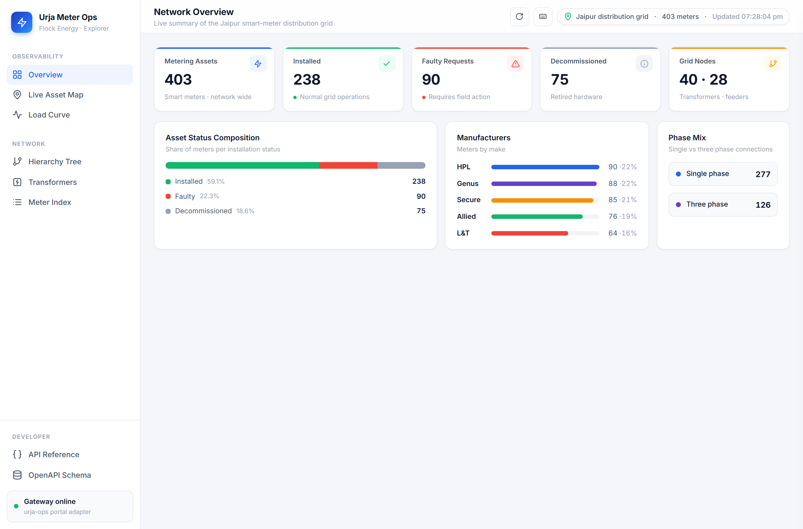
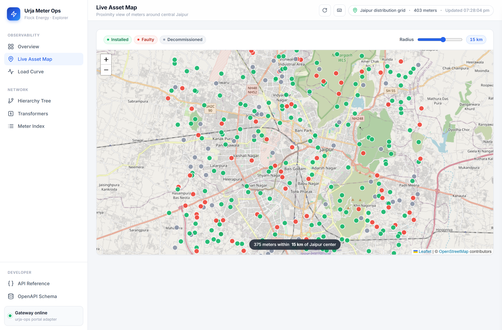
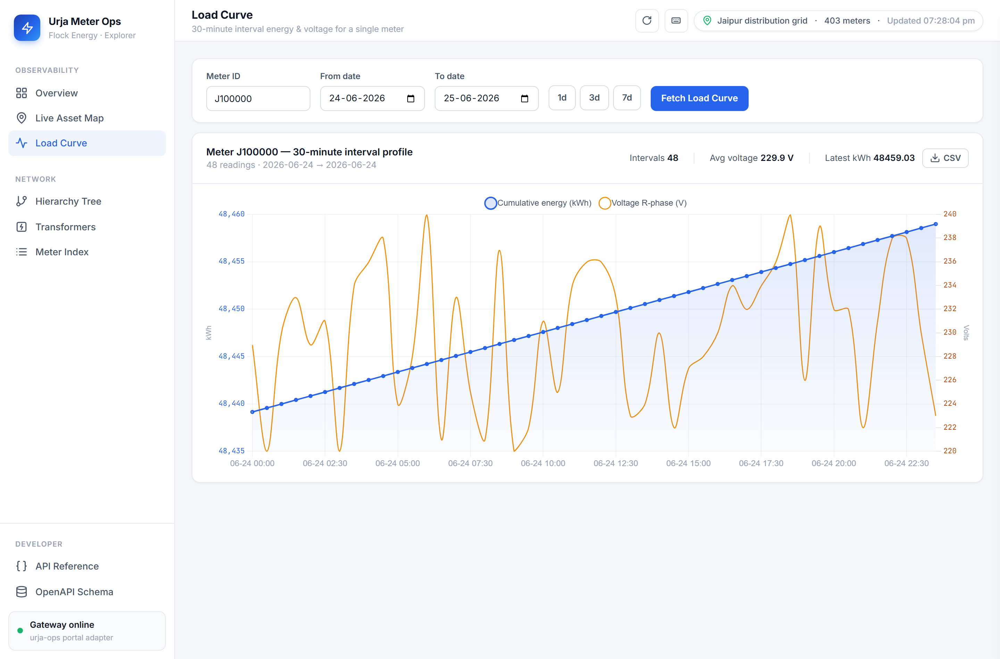
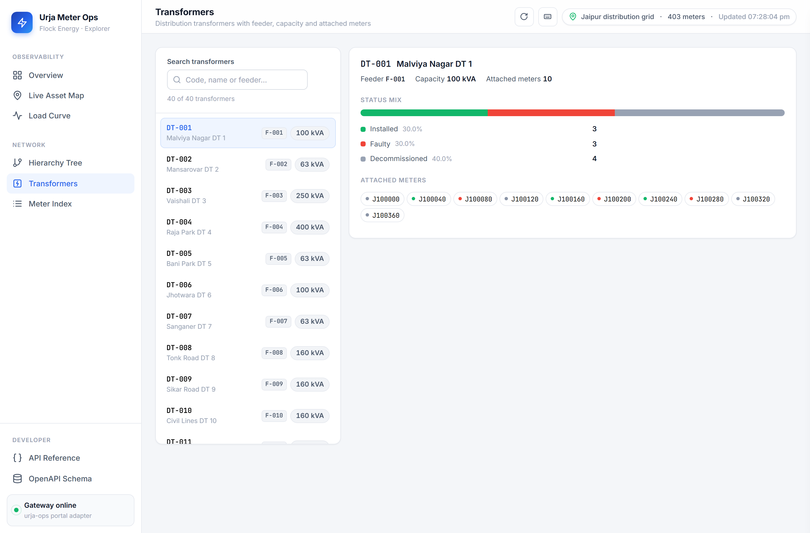

# Urja Meter Ops → REST API

A clean, resilient, and well-documented REST API proxy and data adapter that sits in front of Flock Energy's legacy web portal **"Urja Meter Ops"** (`https://urja-ops.flockenergy.tech`). It automates authentication and session management, transforms messy and non-standard upstream responses into clean structured JSON, surfaces anomalies explicitly via warnings, and provides high-performance extensions (network hierarchy tree, multi-attribute indexing, geospatial proximity search, and an interactive modern web dashboard).

> 🚀 **Live Production Deployment (Vercel):**  
> - **Web Dashboard:** [https://flock-energy-api-nu.vercel.app/](https://flock-energy-api-nu.vercel.app/)  
> - **Interactive Swagger Docs:** [https://flock-energy-api-nu.vercel.app/docs](https://flock-energy-api-nu.vercel.app/docs)  
> - **Health Check:** [https://flock-energy-api-nu.vercel.app/healthz](https://flock-energy-api-nu.vercel.app/healthz)  
> - **Meter API (`/api/v1/meters`):** [https://flock-energy-api-nu.vercel.app/api/v1/meters](https://flock-energy-api-nu.vercel.app/api/v1/meters)  

### Dashboard preview

| | |
|---|---|
|  |  |
|  |  |

*(Screenshots are regenerated offline from real captured portal data: `python scripts/capture_screenshots.py`. More in [`docs/screenshots/`](docs/screenshots).)*

---

## 1. Endpoints Overview

| Method & Route | What it does | Upstream portal call behind it |
|---|---|---|
| `GET /` or `GET /dashboard` | **Modern Web Client Dashboard** (overview analytics, Leaflet map, Chart.js load curve, hierarchy tree, transformers browser, live index with CSV export, keyboard shortcuts) | — (Consumes REST endpoints) |
| `GET /api/v1/meters` | Paginated meter list & search (`q`, `page`, 20/page) | `GET /portal/meters/search` |
| `GET /api/v1/meters/query` | **Local Index Query Layer** (filter by `make`, `phase`, `status`, `dtCode`, `q`) | `GET /portal/export` (cached) |
| `GET /api/v1/meters/nearby` | **Geospatial Proximity Search** (meters within `radius_km` of `lat, lon`) | `GET /portal/export` (cached) |
| `GET /api/v1/meters/{id}` | Meter detail: nameplate parameters, hierarchy breadcrumbs, coordinates | `GET /meters/{id}/__data.json` + `GET /portal/meters/{id}/geo` |
| `GET /api/v1/meters/{id}/consumption` | 30-min energy readings & voltage profile (`from`, `to` dates) | `GET /portal/meters/{id}/energy` |
| `GET /api/v1/transformers` | Distribution transformers list (40 DTs total, 20/page) | `GET /portal/dts` |
| `GET /api/v1/hierarchy` | **Network Hierarchy Tree** (Zone → Circle → Substation → Feeder → DT → Meters) | `GET /portal/export` (cached) |
| `GET /api/v1/stats` | **Operational Metrics** (status, manufacturer, phase, and feeder breakdowns) | `GET /portal/export` (cached) |
| `GET /healthz` | Liveness health probe (never touches portal) | — |
| `GET /docs`, `GET /openapi.json` | Interactive OpenAPI Swagger UI & JSON schema | — |

The legacy portal protocol (auth workflow, cookies, internal endpoints, and quirks) is documented in **[PROTOCOL.md](PROTOCOL.md)**.
Answers to the required reflection questions are documented in **[REFLECTION.md](REFLECTION.md)**.

---

## 2. Project Structure

```
flock-energy-api/
├── app/
│   ├── __init__.py
│   ├── main.py          # FastAPI application, route declarations, and error handlers
│   ├── client.py        # Portal adapter: single-flight re-auth, session jar, HMAC export,
│   │                    # devalue decoding, haversine distance, and normalization
│   ├── models.py        # Pydantic v2 schemas: validation, date parsers, warning mixins
│   ├── config.py        # Environment settings (pydantic-settings)
│   └── dashboard.py     # Modern single-page web client (Vanilla HTML/CSS/JS, Leaflet, Chart.js)
├── tests/
│   ├── conftest.py      # Offline test environment fixtures
│   ├── fixtures/        # Real captured responses from the portal (zero network in tests)
│   │   ├── meters_search_page1.json
│   │   ├── detail_dataraw_j100000.json
│   │   ├── energy_one_day.json
│   │   ├── geo_j100000.json
│   │   ├── dts_page1.json
│   │   ├── portal_export.json
│   │   └── portal_unauthorized.json
│   ├── test_client_reauth.py  # Concurrency lock & session recovery against MockTransport
│   ├── test_config.py         # Config validation and secret leak prevention
│   ├── test_dashboard_csv.py  # CSV exporter unit tests (executes the shipped JS via Node)
│   ├── test_extensions.py     # Hierarchy tree builder, index queries, haversine, and stats
│   ├── test_models.py         # Schema shapes, explicit nulls, and date parsing
│   ├── test_parsing.py        # Pure parsing & devalue decoding against real fixtures
│   └── test_routes.py         # Status codes, validation error mapping, and route coverage
├── tests_e2e/
│   ├── conftest.py            # Boots a real uvicorn server + headless Chromium (Playwright)
│   ├── fake_portal.py         # Offline PortalClient stand-in backed by the same real fixtures
│   └── test_dashboard_e2e.py  # 11 browser tests: views, filters, charts, tree, CSV downloads
├── scripts/
│   ├── export_openapi.py        # Generates openapi.json from app.openapi()
│   ├── capture_screenshots.py   # Regenerates README screenshots offline (Playwright)
│   └── capture_fixtures.py      # Non-destructive fixture capture script for offline tests
├── docs/screenshots/            # Dashboard screenshots used in this README
├── pyproject.toml         # Vercel entrypoint declaration (app.main:app)
├── vercel.json            # Serverless build config (lean bundle via excludeFiles)
├── .vercelignore          # Keeps .env and dev files out of CLI deployments
├── Dockerfile             # Production container image (secrets injected via env)
├── render.yaml            # One-click Render.com blueprint
├── PROTOCOL.md          # Comprehensive verified portal protocol & reverse-engineering notes
├── REFLECTION.md        # Technical reflection & self-critique
├── README.md            # Main documentation & run instructions
├── openapi.json         # Exported OpenAPI 3.1 specification (10 paths)
├── requirements.txt     # Python runtime dependencies
├── requirements-dev.txt # Development/test extras (Playwright for E2E)
└── .env.example         # Environment variables template
```

---

## 3. Quickstart & Installation

Requires **Python 3.10+**.

```bash
# 1. Clone & enter repository
git clone <repo-url>
cd flock-energy-api

# 2. Set up virtual environment
python -m venv .venv

# On Windows:
.venv\Scripts\activate
# On Linux/macOS:
source .venv/bin/activate

# 3. Install dependencies
pip install -r requirements.txt

# 4. Configure credentials (never hardcoded, gitignored)
copy .env.example .env    # On Windows
# cp .env.example .env    # On Linux/macOS
```

Edit `.env` with your Urja portal credentials:
```ini
URJA_USER=operator@urja.local
URJA_PASSWORD=urja-ops-2026
URJA_PORTAL_BASE_URL=https://urja-ops.flockenergy.tech
URJA_TIMEOUT_SECONDS=15.0
URJA_MAX_RETRIES=2
URJA_CACHE_TTL_SECONDS=300
```

### Run the API Server

```bash
uvicorn app.main:app --reload --port 8000
```

- **Interactive Web Client Dashboard**: <http://127.0.0.1:8000/dashboard> or <http://127.0.0.1:8000/>
- **Interactive Swagger Docs**: <http://127.0.0.1:8000/docs>
- **ReDoc Documentation**: <http://127.0.0.1:8000/redoc>
- **OpenAPI 3.1 Specification**: <http://127.0.0.1:8000/openapi.json>

### Run the Test Suite

The unit/integration suite runs **100% offline** using mock transports and real saved fixtures—no portal connection or credentials required:

```bash
pytest -q
# Output: 65 passed in ~8s
```

`tests/test_dashboard_csv.py` executes the dashboard's *shipped* JavaScript CSV exporter (extracted verbatim from `DASHBOARD_HTML`) under Node.js; those tests skip automatically if Node.js is not installed.

### Browser-level E2E Tests (optional)

```bash
pip install -r requirements-dev.txt
python -m playwright install chromium
pytest tests_e2e -q
# Output: 11 passed — a real uvicorn server + headless Chromium click through
# every view (stats, filters, charts, tree toggles, marker map, CSV downloads),
# 100% offline against the fixture-backed fake portal in tests_e2e/fake_portal.py
```

---

## 4. Sample Requests & Responses

### A. 30-Minute Consumption History
Accepts either `YYYY-MM-DD` or `DD/MM/YYYY`. Automatically normalizes parameters and converts numeric strings to floats:

```bash
curl "http://127.0.0.1:8000/api/v1/meters/J100000/consumption?from=24/06/2026&to=24/06/2026"
```

```json
{
  "warnings": [],
  "data": [
    {
      "timestamp": "2026-06-24T00:00:00",
      "kwh": 48439.16,
      "kvah": 52314.29,
      "voltR": 229.0
    },
    {
      "timestamp": "2026-06-24T00:30:00",
      "kwh": 48439.58,
      "kvah": 52314.75,
      "voltR": 220.0
    }
  ],
  "timezone": null
}
```

### B. Network Hierarchy Tree (`GET /api/v1/hierarchy`)
Reconstructs the hierarchical grid distribution tree across all meters:

```bash
curl "http://127.0.0.1:8000/api/v1/hierarchy"
```

```json
{
  "warnings": [
    "meter J100044: feeder 'Feeder 5' had blank code -> reconciled F-005",
    "meter J100078: feeder 'Feeder 11' had blank code -> reconciled F-011"
  ],
  "totalMeters": 403,
  "totalTransformers": 40,
  "totalFeeders": 28,
  "zones": [
    {
      "code": "Z-01",
      "name": "Jaipur Zone 1",
      "circles": [
        {
          "code": "C-01",
          "name": "Circle 1",
          "divisions": [...]
        }
      ]
    }
  ]
}
```

### C. Geospatial Proximity Search (`GET /api/v1/meters/nearby`)
Finds smart meters within a geographic radius (using the Haversine formula) sorted ascending by distance:

```bash
curl "http://127.0.0.1:8000/api/v1/meters/nearby?lat=26.9124&lon=75.7873&radius_km=5.0&limit=3"
```

```json
{
  "warnings": [],
  "originLatitude": 26.9124,
  "originLongitude": 75.7873,
  "radiusKm": 5.0,
  "count": 3,
  "data": [
    {
      "meterId": "J100368",
      "serialNo": "SE20901",
      "make": "Secure",
      "phaseType": "single",
      "installStatus": "Installed",
      "dtCode": "DT-037",
      "latitude": 26.91187,
      "longitude": 75.79284,
      "distanceKm": 0.558
    }
  ]
}
```

### D. Safe Error Handling (No Upstream Leakage)
Unknown resources return clean 404s without leaking credentials, stack traces, or portal HTML:

```bash
curl -i "http://127.0.0.1:8000/api/v1/meters/INVALID_METER"
# HTTP/1.1 404 Not Found
# {"detail": "Meter not found"}
```

---

## 5. Architectural Decisions & Design Trade-offs

1. **Async Execution & Concurrency Locking**:
   - Uses `httpx.AsyncClient` alongside `asyncio.Lock` for session management.
   - When multiple concurrent downstream requests encounter an expired session, **only the first coroutine executes the login POST**. Subsequent coroutines wait on the lock, observe the refreshed cookie token, and safely skip redundant logins.
   - Validated by unit tests firing 10 concurrent requests at an expired session and verifying exactly one login POST.
2. **Tri-State Expiry Signal Normalization**:
   - The portal signals session death in three divergent ways:
     - HTTP 401 on `/portal/*` JSON routes;
     - HTTP 302 redirect on HTML routes;
     - HTTP 200 with `{"type":"redirect","location":"/login"}` on SvelteKit data routes.
   - All three are normalized into a single re-auth pipeline: *re-login once, retry once; if still dead, raise 502*.
3. **SvelteKit Devalue Deserialization**:
   - `/meters/{id}/__data.json` returns SvelteKit's flattened index-referenced object pool (`devalue`).
   - Built a pure, depth-limited recursive deserializer (`_devalue_instantiate`) that reconstructs the true nameplate and hierarchy breadcrumb tree.
4. **Data Anomaly Transparency**:
   - Upstream inconsistencies are surfaced in a `warnings` array on response models rather than being silently dropped or mutated.
   - Empty/whitespace fields become explicit `null`.
   - Incomplete hierarchy records (e.g., meters where `feeder.code` was empty string `""` despite `feeder.name` being `"Feeder 5"`) are canonically reconciled against clean records and logged in `warnings`.
5. **No Blind 5xx Retries**:
   - Transient transport disconnects and timeouts receive polite exponential backoff (0.25s, 0.5s). Upstream `5xx` server errors are **never retried**—they fail immediately as HTTP 502 Bad Gateway to prevent worsening upstream outages.

---

## 6. Optional Extensions Implemented

1. **Network Hierarchy Tree (`GET /api/v1/hierarchy`)**:
   - Reconstructs the complete utility distribution grid: `Zone → Circle → Division → Subdivision → Substation → Feeder → Transformer (DT) → Meters`.
   - Reconciles 22 intermittent portal data omissions (blank codes/names) and surfaces warnings.
2. **Local Index & Multi-Attribute Query Layer (`GET /api/v1/meters/query`)**:
   - Enables multi-parameter filtering that the legacy portal cannot natively perform: filter by `make` (`HPL`, `Genus`, `Secure`, `Allied`, `L&T`), `phase` (`single`, `three`), `status` (`Installed`, `Faulty`, `Decommissioned`), and `dtCode`.
3. **Geospatial Proximity Search (`GET /api/v1/meters/nearby`)**:
   - Pure Python Haversine great-circle calculation returning meters within an arbitrary kilometer radius of any coordinate pair, sorted ascending by distance.
4. **In-Memory Freshness & Caching**:
   - Bulk export data is cached in memory with a configurable TTL (`URJA_CACHE_TTL_SECONDS=300`).
   - Supports on-demand cache bypassing via `?force_refresh=true`.
5. **Full Dataset Extraction via HMAC-SHA256 Bulk Export**:
   - Reverse-engineered the portal's internal export mechanism (`nodes/4.2Bgc2kUI.js`).
   - Implemented dynamic key retrieval from `GET /portal/keys` and computed valid `HMAC-SHA256` signatures to fetch all 403 meters in a single round-trip.
6. **Modern Web Client Dashboard (`GET /dashboard` & `GET /`)**:
   - Light SaaS-style single-page app (vanilla HTML5/CSS/JS — no build step) with a sidebar app shell, hash deep links (`#/overview`, `#/map`, …) and responsive layout down to phone widths.
   - **Network Overview**: live KPI cards, asset-status composition, manufacturer share bars, phase mix (from `/api/v1/stats`, auto-refreshed every 60 s).
   - **Live Asset Map**: status-colored Leaflet markers with a proximity radius slider (`/api/v1/meters/nearby`) and themed popups.
   - **Load Curve**: Chart.js 30-minute interval energy/voltage profile with date presets and CSV export.
   - **Transformers browser**: searchable DT list with per-DT status mix and attached meters.
   - **Hierarchy Tree**: accessible expand/collapse tree across all 403 meters.
   - **Meter Index**: paginated multi-filter query table with **CSV export of the complete filtered set** (RFC 4180 escaping + spreadsheet formula-injection guard).
   - **Meter detail slide-over** with nameplate, hierarchy breadcrumbs, coordinates and anomaly warnings.
   - Keyboard shortcuts (1–6 views, `/` search, `R` refresh, `?` help) and screen-reader-labelled controls.

---

## 7. Scalability & Limits Analysis

> **Prompt Requirement**: *Include a note on at what data scale your approach would start to struggle, and what you'd change.*

Our in-memory caching and index approach is optimized for the current dataset (403 meters, 40 DTs, ~400 KB JSON payload):
- **Memory footprint**: < 1 MB in process RAM.
- **Query latency**: Sub-millisecond (< 1ms) in-memory filter and Haversine scan.
- **Cold start warmup**: Single HTTP call (~1.2s).

### When would this approach start to struggle?

1. **At 50,000 meters (~50 MB RAM)**:
   - Python object overhead and garbage collection pauses become noticeable.
   - Multi-worker deployments (e.g. 8 Uvicorn workers) duplicate memory (400 MB total).
2. **At 500,000 to 5,000,000+ meters (Real-world Utility Scale)**:
   - **Memory Saturation**: Storing millions of Pydantic models in memory would consume several gigabytes of RAM.
   - **Warmup Bottlenecks**: Downloading and parsing a 500 MB JSON bulk export on startup would take 30–60 seconds, during which incoming API requests would block or time out.
   - **CPU Bound Spatial Searches**: An $O(N)$ sequential Haversine scan across 5,000,000 coordinates on every nearby query would saturate CPU cores and cause high latency.

### What would we change at enterprise scale?

- **Dedicated Spatial Database**: Migrate data ingestion into **PostgreSQL with PostGIS** or an embedded **DuckDB** instance.
- **Spatial R-Tree Indexing**: Use GiST spatial indexes (`ST_DWithin`) to perform proximity searches in $O(\log N)$ logarithmic time instead of $O(N)$.
- **B-Tree Composite Indexes**: Index `(make, phase_type, install_status, dt_code)` for instant multi-attribute filtering.
- **Distributed Cache & Streaming ELT**: Use Redis for distributed token and cache storage, and ingest meter updates incrementally via a background worker (Celery/Temporal) rather than pulling full snapshots synchronously in request threads.

---

## 7.5. Deployment

### Docker

```bash
docker build -t urja-meter-ops-api .
docker run --rm -p 8000:8000 --env-file .env urja-meter-ops-api
# API + dashboard on http://localhost:8000
```

The image ships only the runtime code (`app/`, `requirements.txt`) — credentials and dev files never enter it; secrets are injected at runtime via `--env-file` (or orchestrator secrets).

### Render.com (one-click blueprint)

A [`render.yaml`](render.yaml) blueprint is included. On the [Render dashboard](https://dashboard.render.com): **New → Blueprint**, point it at this repo, and fill in the sync-false env vars (`URJA_USER`, `URJA_PASSWORD`, `URJA_PORTAL_BASE_URL`) in the dashboard when prompted. Render builds `requirements.txt` and starts `uvicorn` with the injected `$PORT`.

### Vercel (serverless, free tier)

The application is deployed and live in production:
- **Web Dashboard:** [https://flock-energy-api-nu.vercel.app/](https://flock-energy-api-nu.vercel.app/)
- **Interactive Swagger Docs:** [https://flock-energy-api-nu.vercel.app/docs](https://flock-energy-api-nu.vercel.app/docs)
- **Health Check:** [https://flock-energy-api-nu.vercel.app/healthz](https://flock-energy-api-nu.vercel.app/healthz)

The repo is preconfigured for Vercel's Python runtime — [`pyproject.toml`](pyproject.toml) points at the FastAPI entrypoint (`app.main:app`), and [`vercel.json`](vercel.json) / [`.vercelignore`](.vercelignore) keep credentials out of the build and function bundles lean:

1. **GitHub Continuous Deployment**:
   - Push repository to GitHub (`PushkarKunda/flock-energy-api`).
   - Import into Vercel and configure `URJA_USER`, `URJA_PASSWORD`, and `URJA_PORTAL_BASE_URL` under Project Settings → Environment Variables.
2. **CLI Deployment**:
   ```bash
   npx vercel link
   npx vercel env add URJA_USER --environment production,preview,development
   npx vercel env add URJA_PASSWORD --environment production,preview,development
   npx vercel env add URJA_PORTAL_BASE_URL --environment production,preview,development
   npx vercel deploy --prod
   ```

> **Serverless note**: Session and auth caches are maintained per serverless function instance. After a cold start (~2–4 s to re-authenticate with the portal), warm instances serve subsequent requests sub-millisecond, and async locking safely coordinates concurrent requests under one shared session.

---

## 8. Intentionally Omitted & Out of Scope

- **Modifying / Writing Data**: The portal is treated as strictly read-only; no POST/PUT/DELETE mutations exist on meter records.
- **Persistent Database Dependencies**: Intentionally avoided requiring external PostgreSQL/Redis instances for the initial delivery, ensuring zero-configuration local execution.
- **Brute Force / Fuzzing Testing**: Deliberately avoided aggressive scanning or invalid credential fuzzing against the utility's live portal infrastructure.

---

## 9. Verification Checklist

- [x] Verified all core dependencies install easily (`requirements.txt`).
- [x] Tested endpoint functionality live against `https://urja-ops.flockenergy.tech`.
- [x] Exported up-to-date `openapi.json` matching all 10 endpoint paths.
- [x] Detailed all protocol reverse-engineering findings in `PROTOCOL.md`.
- [x] Completed `README.md` with setup, architecture, curls, and scale analysis.
- [x] Completed `REFLECTION.md` addressing all 5 required prompts in depth.
- [x] 65/65 unit and integration tests passing offline (+4 CSV-exporter tests running the shipped JS under Node).
- [x] 11/11 Playwright E2E tests passing: real browser clicking through every dashboard view, fully offline.
- [x] Dashboard screenshots regenerate reproducibly via `scripts/capture_screenshots.py` (no network).
